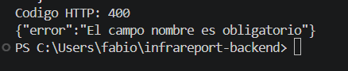

# InfraReport
## Sistema de Diagnóstico de Infraestructura Tecnológica

### Descripción
InfraReport es un proyecto de ingeniería de software
orientado al registro, administración y evaluación
de activos de infraestructura tecnológica empresarial.

El objetivo final es generar informes de diagnóstico
con inventarios, hallazgos, riesgos y recomendaciones.

### Tecnologías
- Node.js
- Express
- SQLite
- JavaScript
- Vite
- API REST
- Git y GitHub

### Arquitectura
El backend implementa las siguientes capas:

1. Routes: definición de endpoints.
2. Controllers: gestión HTTP.
3. Services: validaciones y reglas de negocio.
4. Repositories: operaciones SQL.
5. Database: conexión centralizada SQLite.

### Entidad principal
Activos tecnológicos.

Campos:
- ID
- Empresa
- Nombre
- Tipo
- Marca
- Modelo
- Dirección IP
- Estado
- Criticidad
- Observaciones
- Fecha de creación

### Instalación

Consulta [Ejecución local](#ejecución-local) para iniciar ambos servicios.

### Endpoints

| Método | Ruta | Función |
|---|---|---|
| GET | /api/activos | Listar |
| GET | /api/activos/:id | Consultar |
| POST | /api/activos | Crear |
| PUT | /api/activos/:id | Actualizar |
| DELETE | /api/activos/:id | Eliminar |

### Validaciones
La capa de servicios verifica los campos
obligatorios y los valores permitidos.

### Pruebas realizadas

- HTTP 201: creación exitosa.
- HTTP 400: validación de datos.
- HTTP 404: recurso inexistente.
- HTTP 200: consulta y actualización.
- HTTP 204: eliminación exitosa.

### Evidencias

**Creación exitosa**


**Error de validación**



**Recurso no encontrado**


### Futuras funcionalidades
- Registro de empresas.
- Inventario tecnológico avanzado.
- Evaluación de infraestructura.
- Matriz de riesgos.
- Generación de informes PDF.

## Integración de frontend y API

### Ejecución local

Necesitas Git y Node.js 22.12 o posterior en la serie 22, o Node.js 24 o posterior.

Si todavía no tienes el proyecto, clona el repositorio. Si ya lo tienes, ejecuta los pasos siguientes en la raíz de tu copia local.

```powershell
git clone https://github.com/fadiazr-gif/infrareport-backend.git
cd infrareport-backend
```

Instala las dependencias del backend y del frontend. Copia la configuración de ejemplo si todavía no existe un archivo `.env`.

```powershell
npm.cmd ci
npm.cmd --prefix frontend ci
if (-not (Test-Path .env)) { Copy-Item .env.example .env }
```

La configuración de ejemplo usa el puerto 3000, guarda los datos en `data/app.db` y autoriza el origen `http://localhost:5173`. Si ya tienes una base de datos en uso, conserva el valor de `DB_FILE` en tu configuración. Si OneDrive impide instalar las dependencias, usa una copia en una carpeta local fuera de OneDrive.

Abre dos terminales en la raíz del repositorio y mantenlas abiertas al mismo tiempo.

| Terminal | Comando | Dirección |
|---|---|---|
| Backend Express y SQLite | `npm.cmd start` | [API de activos](http://localhost:3000/api/activos) |
| Frontend Vite | `npm.cmd run frontend` | [InfraReport](http://localhost:5173) |

Usa `localhost` en el navegador para que coincida con `FRONTEND_ORIGIN`. Si la API usa otro puerto, define primero `$env:VITE_API_URL = 'http://localhost:3001/api/activos'` en la terminal del frontend. Si Vite usa otro puerto, ajusta `FRONTEND_ORIGIN` y reinicia el backend.

### Verificar el CRUD y los errores en el navegador

Abre InfraReport y, en las herramientas de desarrollador, usa la pestaña **Red** para comprobar el método y el estado HTTP. Usa un activo de demostración para las pruebas de edición y eliminación.

| Prueba | Pasos en la interfaz | Resultado esperado |
|---|---|---|
| GET 200 | Abre la página o pulsa **Actualizar activos**. | Se muestra el inventario. |
| POST 400 | Introduce una empresa de prueba y escribe solo espacios en **Nombre del activo**. Selecciona tipo, estado y criticidad. Pulsa **Guardar activo tecnológico**. | Aparece **HTTP 400: El campo nombre es obligatorio**. La API recibe el nombre como una cadena vacía tras recortar los espacios. El inventario conserva sus registros. |
| POST 201 | Corrige el nombre, por ejemplo a **Switch de demostración**, y vuelve a guardar. | Aparece un mensaje de creación y se agrega la fila. |
| PUT 200 | Pulsa **Editar** sobre el activo de prueba, cambia su estado y guarda. | Se muestra el estado actualizado. |
| DELETE 204 y PUT 404 | Abre el inventario en dos pestañas. En la segunda, pulsa **Editar** sobre el activo de prueba. En la primera, elimínalo y confirma. Regresa a la segunda y guarda la edición pendiente. | La eliminación devuelve **204**. La edición pendiente muestra **HTTP 404: Activo tecnológico no encontrado**. Pulsa **Cancelar edición** y luego **Actualizar activos** para sincronizar el inventario. |

Una IP inválida, como `300.1.2.3`, se rechaza en el formulario antes de enviar una solicitud. La prueba del nombre con espacios permite comprobar una respuesta **400** real del backend.

Las pruebas de integración de la API se ejecutan con `npm.cmd test` y usan una base SQLite temporal. La compilación del frontend se comprueba con `npm.cmd --prefix frontend run build`.

### Evidencias de las pruebas en el navegador

Las capturas se tomaron en Edge con un inventario temporal y datos de demostración.

- [HTTP 400 en el formulario de registro](evidencias/actividad-11/frontend-http-400.png)
- [HTTP 404 al guardar una edición pendiente](evidencias/actividad-11/frontend-http-404.png)

La configuración local `.env` y la base `app.db` están excluidas por `.gitignore`. El repositorio incluye `.env.example` para preparar una instalación nueva.
