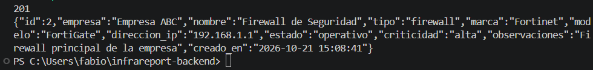
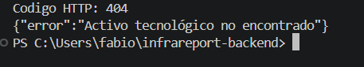

# InfraReport
## Sistema de Diagnóstico de Infraestructura Tecnológica

### Descripción
InfraReport es un proyecto de ingeniería de software
orientado al registro, administración y evaluación
de activos de infraestructura tecnológica empresarial.

El objetivo final es generar informes de diagnóstico
con inventarios, hallazgos, riesgos y recomendaciones.

### Tecnologías
- Node.js
- Express
- SQLite
- JavaScript
- API REST
- Git y GitHub

### Arquitectura
El backend implementa las siguientes capas:

1. Routes: definición de endpoints.
2. Controllers: gestión HTTP.
3. Services: validaciones y reglas de negocio.
4. Repositories: operaciones SQL.
5. Database: conexión centralizada SQLite.

### Entidad principal
Activos tecnológicos.

Campos:
- ID
- Empresa
- Nombre
- Tipo
- Marca
- Modelo
- Dirección IP
- Estado
- Criticidad
- Observaciones
- Fecha de creación

### Instalación
1. Clonar el repositorio.
2. Ejecutar npm install.
3. Copiar .env.example a .env.
4. Ejecutar npm run dev.

Servidor: http://localhost:3000

### Endpoints

| Método | Ruta | Función |
|---|---|---|
| GET | /api/activos | Listar |
| GET | /api/activos/:id | Consultar |
| POST | /api/activos | Crear |
| PUT | /api/activos/:id | Actualizar |
| DELETE | /api/activos/:id | Eliminar |

### Validaciones
La capa de servicios verifica los campos
obligatorios y los valores permitidos.

### Pruebas realizadas

- HTTP 201: creación exitosa.
- HTTP 400: validación de datos.
- HTTP 404: recurso inexistente.
- HTTP 200: consulta y actualización.
- HTTP 204: eliminación exitosa.

### Evidencias

**Creación exitosa**

**Error de validación**

**Recurso no encontrado**

### Futuras funcionalidades
- Registro de empresas.
- Inventario tecnológico avanzado.
- Evaluación de infraestructura.
- Matriz de riesgos.
- Generación de informes PDF.
- Interfaz web.
